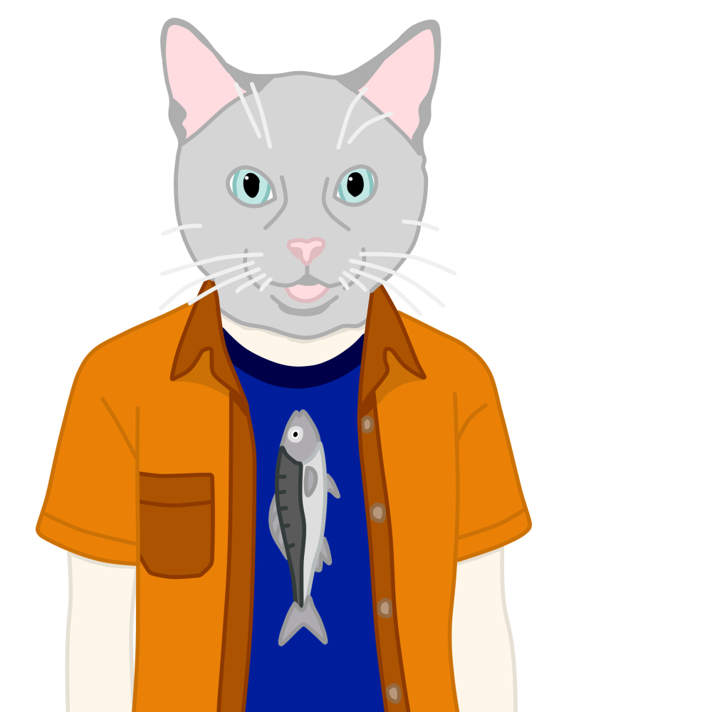

  

  <strong>A Five Stage Protocol Handling Decentralized Sync and Communication</strong>

Yuuko Protocol is a decentralized protocol created for the XRUIOS; it uses "The Holy Mother", an orchestrator, to handle a multitude of datastreams like files, realtime data, messages and even videos alongside syncing.

<strong>Cross Platform • Internet, Wifi Direct or Wired • Post Quantum Computing Resistant • No BS</strong>

  <a href="https://walker-industries-rnd.github.io/YuukoProtocol/1-welcome" 
     style="font-size: 1.4em; color: #58a6ff; text-decoration: none;">
    <strong>Documentation • Examples • API Reference</strong>
  </a>

---

## Core Features Planned

- "The Holy Mother", handles creating and managing application streams automatically
- Nintendo Streetpass style communication between devices, minimal bandwidth and high count support
- XMPP based notifications 
- WebRTC + Facade (WIP) Based Interaction And Video Streaming
- Event Sourcing - Trust and Permissions
- CRDT System - Realtime UI and States
- Git Style System - File and Assets
- AES-256-GCM for request/response payloads  
- Hard for third-party processes to inject or read traffic  
- Designed for local-first scenarios (desktop apps ↔ local LLMs ↔ tools ↔ services)  
- No central server required beyond the machine itself  

---

## Meet the Team

|  |  |  |
| --- | --- | --- |
| **Jpena173** Backend Support / Development Help [GitHub](https://github.com/jpena173)  "I cant think of a quote you can leave it alone for now" | **WalkerDev** Founder / Lead Developer  “Don't be afraid of change—Think of it as something that'll open the door to deeper, more precious feelings for you in the future.” [YouTube](https://www.youtube.com/@walkerdev1) | **Tʜᴇ Rᴇᴀʟ ANTWAN**  Artist  "Time is something no one can escape. It delivers us all to the same end. You can't plug your eyes or cover your eyes."  |

---

### Measured performance (in-process; excludes network)

| Metric                                 | Result                  |
| -------------------------------------- | ----------------------- |
| Post-quantum handshake + first request | ~2.4 ms/peer (one-time) |
| Warm request round-trip (serial)       | ~54 µs → ~18,500 req/s  |
| Throughput (concurrent, 8–32 lanes)    | ~33–40k req/s           |
| Raw AES-256-GCM enc+dec (256 B)        | 3.6 µs/op → ~280k op/s  |
|                                        |                         |

## Requirements

The following (Free, Open Source Solutions on our Github) libraries are required for this to workl

[- Pariah Cybersecurity ](https://github.com/Walker-Industries-RnD/PariahCybersecurity)
[- Secure Store ](https://github.com/Walker-Industries-RnD/Secure-Store/tree/main)

Check these out!

[The XRUIOS; the project this was made for! ](https://xruios.xyz/)

## Stages

- [x] Zenoh C# Based API Created
- [x] Eclipse-Secured Handshake + Per-Peer Encrypted Sessions (Kyber-1024 + AES-256-GCM)
- [x] Multiplexed Lanes (parallel encrypted requests per peer)
- [ ] Connected Endpoints Handler
- [ ] CRDT Handler
- [ ] Operational Transformation Handler
- [ ] Event Sourcing Handler
- [ ] Git Style DAG + Keeper Of Tomes
- [ ] Service Handler
- [ ] Trust Based Sync Visibility
- [ ] Easy BLE/Wifi Handling
- [ ] P2P Mesh (Secure) — secure core done; discovery/replication pending

## Security (Implemented)

Built and benchmarked — see [[1 - System Design]] for numbers (~2.4 ms post-quantum handshake, then ~54 µs warm request round-trips; the crypto is effectively free).

- **Enrollment** → registers client ID + PSK  
- **Handshake** → Kyber-encrypted key exchange → shared secret  
- **Session** → AES-256-GCM + per-message nonces  
- **Transcript** → HMAC-protected log of handshake messages → prevents downgrade & MITM  
- Designed to resist classical & quantum adversaries (where Kyber helps)

---

## License & Artwork

**Code**  
[NON-AI MPL 2.0](https://raw.githubusercontent.com/non-ai-licenses/non-ai-licenses/main/NON-AI-MPL-2.0)

This software is licensed under MPL 2.0 **with the following exception**:

**Artwork**  
© Its a ANTWAN — **NO AI training. NO reproduction. NO exceptions.**

> Unauthorized use of the artwork — including copying, distribution, modification, or inclusion in any machine-learning training dataset — is strictly prohibited and will be prosecuted to the fullest extent of the law.
